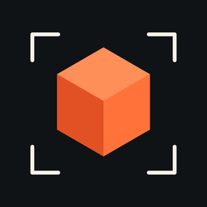
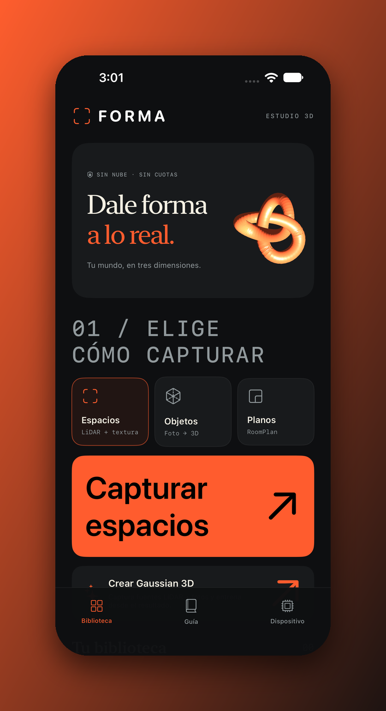
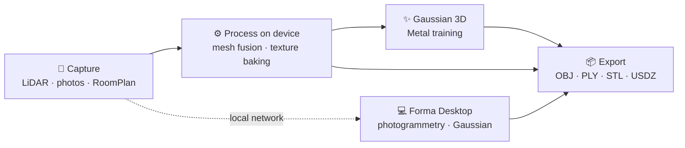

<div align="center">



# Forma

### Local 3D scanning studio for iPhone, iPad & Mac

**LiDAR + photogrammetry + Gaussian Splatting — 100% on device. No cloud, no account, no subscription.**

[](https://github.com/RobiiAragon/Forma/releases/latest)
[](https://github.com/RobiiAragon/Forma/actions)


[](LICENSE)

[**Download**](https://github.com/RobiiAragon/Forma/releases/latest) · [Features](#features) · [Workflow](#workflow) · [Build](#build-from-source) · [Español](README.es.md)



</div>

---

Forma turns your surroundings into 3D assets you can keep. It brings LiDAR space capture, object photogrammetry, room layouts and Gaussian Splatting together in one native app — and every step, from capture to export, runs on your own hardware.

## Features

| | |
| --- | --- |
| 🏠 **Spaces** | Combines the ARKit LiDAR mesh with calibrated, posed photographs to build textured room models. |
| 🧸 **Objects** | Uses Apple's Object Capture and on‑device photogrammetry to produce textured USDZ models. |
| 📐 **Room layouts** | Organizes walls, doors and windows with RoomPlan. |
| ✨ **Gaussian 3D** | Trains Gaussian Splatting scenes from saved photos and cameras with a native Metal engine (adapted from [msplat](https://github.com/frs0n/msplat-ios)). Pick resolution and iterations, resume from checkpoints. |
| 🔁 **Hybrid iPhone ⇄ Mac** | Sends capture sources over your local network to **Forma Desktop** for heavier processing — no server in between. |
| 🧠 **Local AI texture restoration** | Optional Core ML (Real‑ESRGAN) texture enhancement, on device. |
| 📦 **Export** | OBJ, PLY, STL or USDZ depending on the capture type. Originals are never overwritten — reprocessed results are saved as separate copies. |
| ⏸️ **Built for long jobs** | Pause, resume and automatic checkpoints; progress in a Live Activity / Dynamic Island. |

> [!NOTE]
> The interface is currently in **Spanish**. English localization is on the roadmap.

## Workflow



1. **Capture** — LiDAR mode for spaces (initial mesh + posed photos), Object Capture for items, RoomPlan for floor plans.
2. **Process** — the engine optimizes photos and fuses geometry conservatively. Optional planar denoising only touches regions that pass strict checks, preserving edges. No fake detail is added by subdivision.
3. **Explore** — rotate, zoom, switch between texture and geometry, inspect estimated measurements.
4. **Export** — take your model anywhere.

## Install

### Forma Desktop (macOS)

1. Download **`Forma-Desktop-<version>-macOS.zip`** from the [latest release](https://github.com/RobiiAragon/Forma/releases/latest).
2. Unzip and move **FormaDesktop.app** to **Applications**.
3. It's ad‑hoc signed (not notarized): **right‑click → Open** the first time, or run
   `xattr -dr com.apple.quarantine /Applications/FormaDesktop.app`.

Requires Apple Silicon for the Gaussian worker.

### Forma for iPhone / iPad

Apple doesn't allow installing iOS apps from GitHub directly, so there are two options:

- **Sideload** the unsigned **`Forma-<version>-iOS-unsigned.ipa`** from the release with a tool such as AltStore or Sideloadly (it re‑signs the app with your Apple ID).
- **Build from source** with Xcode and your own (free) Apple developer account — see below.

Device requirements: iOS/iPadOS 18+. Spaces and room capture need **LiDAR**; Objects needs Object Capture support. The in‑app **Device** screen tells you what your hardware supports.

## Build from source

**Requirements:** Xcode 16+ (developed with Xcode 27), CMake 3.21+, Ninja and Python 3.

```sh
git clone https://github.com/RobiiAragon/Forma.git
cd Forma
brew install cmake ninja
bash scripts/build_msplat.sh          # builds the Metal Gaussian engine (iOS + Simulator)
bash Tools/build_gaussian_worker.sh   # builds the macOS Gaussian worker (for Forma Desktop)
open Forma.xcodeproj
```

- **iPhone / iPad:** select the **Forma** scheme, set your team under *Signing & Capabilities*, pick a device and press <kbd>⌘</kbd><kbd>R</kbd>.
- **Mac:** select the **FormaDesktop** scheme and **My Mac**.

> [!TIP]
> `scripts/generate_project.py` regenerates the Xcode project if you add files that should be shared between the iOS and macOS targets. See [docs/MODULE_MAP.txt](docs/MODULE_MAP.txt).

### Tests

```sh
xcodebuild test -project Forma.xcodeproj -scheme Forma \
  -destination 'platform=iOS Simulator,name=<your simulator>' -parallel-testing-enabled NO
```

## Architecture

```
Forma/                 iOS / iPadOS app
  Core/                Models, processing pipelines, persistence, exporters, Gaussian trainer
  Features/            Capture, library, detail, Gaussian and device screens
  Presentation/        Branding and reusable SwiftUI components
Mac/                   Forma Desktop (photogrammetry, Gaussian, local AI, viewer)
FormaLiveActivity/     Live Activity / Dynamic Island progress
Shared/                Types shared by app and extensions
Vendor/Msplat/         Metal Gaussian Splatting engine (Apache‑2.0, with local hardening)
Tools/ · scripts/      Build, verification and benchmark tooling
docs/                  Engineering notes, validation protocols and audits (Spanish)
```

SwiftUI + ARKit + RealityKit/SceneKit + Metal + Core ML, MVVM‑style view models with services doing the heavy lifting. More in [docs/MODULE_MAP.txt](docs/MODULE_MAP.txt), [PERFORMANCE.md](PERFORMANCE.md) and [docs/VALIDATION_PROTOCOL.md](docs/VALIDATION_PROTOCOL.md).

## Limitations

Forma produces **estimates**, not certified metrology. Unobserved areas, reflective or transparent surfaces and moving objects can cause artifacts. Gaussian scenes are a visual representation, not measurement geometry. Heavy Metal jobs may require keeping the app in the foreground.

## Roadmap

- [ ] English localization
- [ ] TestFlight / App Store distribution
- [ ] Notarized Forma Desktop builds

## Acknowledgements

- [msplat-ios](https://github.com/frs0n/msplat-ios) — Apache License 2.0 (see [Vendor/Msplat/LICENSE](Vendor/Msplat/LICENSE))
- [Real‑ESRGAN](https://github.com/xinntao/Real-ESRGAN) — BSD 3‑Clause (see [Mac/Resources/RealESRGAN-LICENSE.txt](Mac/Resources/RealESRGAN-LICENSE.txt))
- nlohmann/json, nanoflann and CLI11, fetched at build time

## License

[MIT](LICENSE) © RobiiAragon — third‑party components keep their own licenses.
